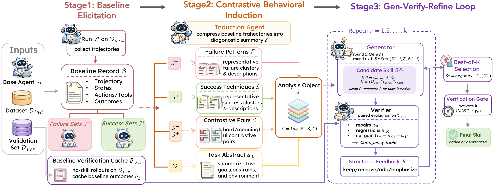

# SkillGen: Verified Inference-Time Agent Skill Synthesis

## (NeurIPS 2026)




Official implementation of **[SkillGen: Verified Inference-Time Agent Skill Synthesis](https://arxiv.org/abs/2605.10999)**, accepted at **NeurIPS 2026**.

## Requirements

```bash
pip install -r requirements.txt
```

Set the following environment variables:

```bash
export OPENROUTER_API_KEY="sk-or-..."   # LLM chat (OpenRouter)
export OPENAI_API_KEY="sk-..."          # embeddings (OpenAI)
```

## Quick Start

```bash
# Train: discover a skill on the training split
python main.py data/aime/train.json --config config.yaml

# Eval: test the discovered skill on the held-out split
python eval_skill.py \
    --skill-path ./skill_output/<run>/skill.json \
    --test-data  data/aime/test.json \
    --config     config.yaml
```

Results are written to `./skill_output/<timestamp>/skill.json`.

## Dataset Format

```json
{
  "dataset_id": "my_task",
  "task_name": "My Task",
  "task_type": "binary",
  "instances": [
    {"instance_id": "1", "input": "task description", "ground_truth": "expected answer"}
  ]
}
```

`task_type` options: `binary` (LLM judge pass/fail), `scored` (numeric threshold), `open_ended` (LLM quality judge).

The bundled datasets under `data/` are the exact splits used in our experiments and are ready to use directly. To prepare additional splits, use the scripts under `scripts/`.

## Preparing Additional Benchmark Datasets

```bash
# Generic (PubMedQA, AIME, ...)
python scripts/prepare_benchmarks.py --benchmark pubmedqa --n 500 -o data/pubmedqa.json

# ChemLLMBench
python scripts/prepare_chemllmbench.py -o data/chemllmbench.json

# MCP-Bench (requires: git clone https://github.com/Accenture/mcp-bench.git external/mcp-bench)
python scripts/prepare_mcp_bench.py --split single --train-n 40 --test-n 16

# ScienceWorld (requires: clone allenai/ScienceWorld and unzip goldpaths-all.zip)
python scripts/prepare_scienceworld.py --train-n 150 --test-n 100

# SocialMaze
python scripts/prepare_socialmaze.py --variant fts -o data/socialmaze_fts.json

# ToolBench (requires: clone OpenBMB/ToolBench)
python scripts/prepare_toolbench.py --subset G1_instruction --train-n 120 --test-n 50

# TAU-Bench
python scripts/prepare_tau_bench.py -o data/tau_bench.json
```

## SkillOpt SearchQA

From the SkillGen root, the default data directory is `../SkillOpt/data/searchqa_split`.
Only its three `items.json` files are needed. Set `SEARCHQA_SPLIT_DIR` or pass
`--split-dir` to use the same payloads at a different path. The adapter verifies
the fixed ordered ID lists and constructs and scores each example locally.
Check the data without loading a model:

```bash
python -m benchmarks.searchqa --check
```

To train and test, give the command a new output directory:

```bash
python -m benchmarks.searchqa --config config.yaml --output outputs/searchqa-run1
```

The pipeline learns from the 400 train items. It caches one no-skill response
on each of the 200 dev items, then uses the original paired verification and
refinement rules on the entire dev set. The benchmark replaces the generic
LLM outcome judge with SkillOpt normalized EM; the other agent roles and
thresholds follow the supplied configuration. Test reports EM and token F1 on
all 1,400 fixed items. A rejected skill reuses the no-skill test result.
Use `--skill-repo <timestamped-skill-directory>` to evaluate a saved run.

To use one OpenAI-compatible chat deployment for all SearchQA roles, export
`OPENAI_COMPATIBLE_BASE_URL`, `OPENAI_COMPATIBLE_API_KEY` and
`OPENAI_COMPATIBLE_MODEL` before invoking the same command. For the comparison
set `TARGET_OPENAI_COMPATIBLE_MAX_TOKENS=131072` for each answer,
`OPTIMIZER_OPENAI_COMPATIBLE_MAX_TOKENS=131072` as the ceiling for native
skill-generation and analysis requests, and `SKILLOPT_WORKERS=24` for train,
dev and test answer rollouts. For SiliconFlow clustering, set
`EMBEDDING_BASE_URL=https://api.siliconflow.cn/v1`, `EMBEDDING_API_KEY` and
`EMBEDDING_MODEL=BAAI/bge-m3`. The full URL ending in `/embeddings` also works.

### Original SearchQA run on the CPU server

The first run (`20261124-r1`, code `805bcd7`) stopped during failure summarization when TokenHub returned HTTP 400 with `Requests rate limit exceeded`. Its launch command is in `git show 68d4d72:README.md`. The fresh run below uses the checked-in `config.yaml` and handles this response with the existing exponential backoff (six attempts total). It recomputes training trajectories, embeddings, skills and evaluations in a new working directory. From a Bash shell on `ssh cpu`, supply the two service keys in the environment. If needed, enter them with `read -rs -p 'TokenHub key: ' OPENAI_COMPATIBLE_API_KEY; echo; export OPENAI_COMPATIBLE_API_KEY` and the equivalent command for `EMBEDDING_API_KEY`. The dedicated tmux server inherits the exported credentials when it starts.

```bash
# CPU tmux launch (20261124-r2)
(
  set -eu
  : "${OPENAI_COMPATIBLE_API_KEY:?export the TokenHub key first}"
  : "${EMBEDDING_API_KEY:?export the SiliconFlow key first}"
  session=sq-original-skillgen-r2
  out="$HOME/searchqa-original-runs/20261124-r2/skillgen"
  if tmux -L "$session" has-session -t "$session" 2>/dev/null; then
    echo "Session $session is already running" >&2
    exit 1
  fi
  umask 077
  mkdir -p "${out%/*}"
  mkdir "$out"
  tmux -L "$session" new-session -d -s "$session" -c "$out" bash -o pipefail -c '
    repo=/mnt/sdd3/xuancheng/code/github/SkillGen
    export PYTHONPATH="$repo"
    export OPENAI_COMPATIBLE_BASE_URL=https://tokenhub.sensetime.com/v1
    export OPENAI_COMPATIBLE_MODEL=deepseek-v4.1-flash-1017/huoshan_L/sfc
    export TARGET_OPENAI_COMPATIBLE_MAX_TOKENS=131072
    export OPTIMIZER_OPENAI_COMPATIBLE_MAX_TOKENS=131072
    export SKILLOPT_WORKERS=24
    export EMBEDDING_BASE_URL=https://api.siliconflow.cn/v1/embeddings
    export EMBEDDING_MODEL=BAAI/bge-m3
    {
      git -C "$repo" rev-parse HEAD &&
      "$HOME/miniconda3/envs/rdagent/bin/python" -B -u -m benchmarks.searchqa \
        --config "$repo/config.yaml" \
        --split-dir /mnt/sdd3/xuancheng/code/github/SkillOpt/data/searchqa_split \
        --output "$PWD/test"
    } 2>&1 | tee console.log
    status=$?
    printf "%s\n" "$status" > exit.status
    exit "$status"
  '
)
```

Attach with `tmux -L sq-original-skillgen-r2 attach -t sq-original-skillgen-r2` or follow `console.log` in the run directory. Native training and dev artifacts are under `artifacts/runs/`, candidate skills under `candidates/`, and the retained skill under `skill_output/`. The held-out scores are in `test/summary.json` and test usage is in `test/test_token_usage.json`. `exit.status` is written when the process exits (`0` for success). Use a fresh output directory for a repeat.

### Optional ranked dev validation (fixed SearchQA)

The normal SearchQA command evaluates every candidate on the entire dev set.
To evaluate only one dev batch at a time, add `--dev-early-stop` to
`python -m benchmarks.searchqa`. The defaults are `--dev-order hard-first`
and `--dev-batch-size 4`. Use `--dev-order easy-first` to try the opposite
order. Each question is ranked by mean EM over its observed versions, starting
with the full no-skill dev pass. Ties use the fixed manifest order.

**Certified acceptance** is a separate opt-in, `--dev-early-accept`. For
`N` fixed dev questions, let `B` be the baseline correct count and keep the
native minimum net gain `g = max(1, min_net_gain_abs, ceil(min_net_gain_rel * N))`.
After a batch with `k` evaluated and `c` correct in total, the candidate's
final correct count lies in `[c, c + N - k]`. With certified acceptance
enabled, `c >= B + g` passes the existing first-passing-candidate gate. A
candidate that cannot pass is still fully evaluated because its cases and
exact net gain are used for refinement and best-candidate bookkeeping. With
only `--dev-early-stop`, both passing and failing candidates finish dev.
Training keeps its native first-pass termination, and both test evaluations cover the full held-out split.

For example, append `--dev-early-stop --dev-order easy-first --dev-batch-size 4 --dev-early-accept` to the fixed SearchQA training command in a new output
directory. Each round's `verification_summary.json` records the evaluated
IDs, bounds, batch checkpoints and stopping reason in `dev_evaluation`. A
partial pass has null full-candidate metrics; the case analyst and revision
synthesiser still process the observed diagnostic cases. Only measured IDs
enter the next history update. In the archived r2 run the fixed baseline
scored 119/200, the candidate 152/200 and the pass threshold was 129. Replaying
those answers in batches of four certifies the pass after 180 questions with
hard-first and 144 with easy-first.

## Fixed TriviaQA, HotpotQA and BIRD

Select a task with `--benchmark` on the native fixed-split runner. SearchQA remains the default. All four tasks use SkillGen's own agent, induction, generation, paired verification and held-out evaluation. The additional tasks currently use the original full verification workflow. Configure the same chat and embedding environment as in the fixed SearchQA run above.

| Benchmark | Train / dev / test | Grade |
|---|---|---|
| `triviaqa` | 1,600 / 200 / 1,000 | Multi-reference EM and token F1 on the supplied evidence |
| `hotpotqa` | 1,600 / 200 / 1,000 | Answer EM and token F1 on the supplied passages |
| `bird` | 834 / 200 / 500 | SQLite execution accuracy (EX), including the fixed mini-dev test |

The loader reads the existing `../SkillOpt/data/<benchmark>_split` relative to this checkout and checks the exact ordered IDs of each split. Use `--split-dir` or `TRIVIAQA_SPLIT_DIR`, `HOTPOTQA_SPLIT_DIR` or `BIRD_SPLIT_DIR` to override the data directory. Only the dataset and SQLite files are shared with the reference. For BIRD, the task input is the complete materialized `prompt`; the reference SQL and database path reach the grader separately. The grader extracts the first SQL statement, opens the database read-only, executes the prediction and reference with one 30-second deadline and compares sets of full result rows. SQL errors and timeouts receive EX 0 in train, dev and test. Use `--db-root` or `BIRD_DB_ROOT` to change the default `/mnt/sdd3/xuancheng/code/github/bird-text-to-sql-260820/data_dev/dev_databases`.

From the SkillGen checkout on the CPU server, validate locally available data without model calls:

```bash
for bench in triviaqa hotpotqa bird; do
  "$HOME/miniconda3/envs/rdagent/bin/python" -B -m benchmarks.searchqa --benchmark "$bench" --check || exit 1
done
```

For a full run, choose a new output directory for each task and repetition. For example, with the existing provider variables exported:

```bash
bench=bird
"$HOME/miniconda3/envs/rdagent/bin/python" -B -u -m benchmarks.searchqa --benchmark "$bench" \
  --config config.yaml --output "$HOME/fixed-benchmark-runs/$bench/skillgen-run1"
```

For the three new tasks, this directory contains training artifacts under `artifacts/runs/`, candidate and promoted skills under `candidates/` and `skill_output/`, and the held-out `baseline.jsonl`, `skill.jsonl` (when a skill is deployed), `summary.json` and `test_token_usage.json`. The BIRD summary includes `ex`, `agent_errors`, `sql_errors` and `sql_timeouts`; all test rows remain in the denominator.

## Configuration

All hyperparameters are in `config.yaml`. The most commonly adjusted fields:

| Field | Default | Description |
|-------|---------|-------------|
| `models.baseline_agent` | `gpt-5.4-nano` | Agent model for baseline and verification |
| `models.generation_execute` | `gpt-5.4-mini` | Skill generation model |
| `pipeline.max_refine_rounds` | `8` | Max generation/refinement iterations |
| `pipeline.max_workers` | `16` | Parallel worker threads |
| `verification.sample_size` | `120` | Verification split size |
| `clustering.method` | `kmeans` | Clustering algorithm |

## File Structure

```
skillgen_paper/
  main.py              - CLI entry point
  pipeline.py          - End-to-end pipeline orchestration
  models.py            - Data models (TaskInstance, Trajectory, SkillItem, ...)
  llm.py               - LLM / embedding / web-search client wrappers
  trajectory.py        - Agent runner and LLM-judge evaluator
  clustering.py        - Failure/success trajectory clustering
  effectiveness.py     - Paired baseline-vs-skill verification
  skill_store.py       - Skill serialization and persistence
  router.py            - Per-instance skill-application gate
  eval_skill.py        - Held-out test evaluation
  artifacts.py         - Checkpoint and artifact helpers
  logging_utils.py     - Logging setup
  config.yaml          - Hyperparameters
  requirements.txt     - Python dependencies
  agents/
    induction.py       - Induction Agent
    generation.py      - Generation Agent
    verification.py    - Verification Agent
  prompts/             - LLM prompt templates
  benchmarks/          - Per-benchmark adapters and graders
  scripts/             - Dataset preparation scripts
  data/                - Benchmark splits used in experiments 
    aime/              - AIME olympiad math  
    pubmedqa/          - PubMedQA biomedical QA  
    mcp_bench/         - MCP-Bench tool-use planning  
    mind2web/          - Mind2Web web navigation  
    scienceworld/      - ScienceWorld science tasks  
    socialmaze/        - SocialMaze social reasoning  
    toolbench/         - ToolBench API-use planning  
```


## 📖 Citation

If you find this repository useful, please cite our paper:

```bibtex
@inproceedings{ma2026skillgen,
  title={{SkillGen}: Verified Inference-Time Agent Skill Synthesis},
  author={Ma, Yuchen and Huang, Yue and Bao, Han and Zhuang, Haomin and Shukla, Swadheen and Galley, Michel and Zhang, Xiangliang and Feuerriegel, Stefan},
  booktitle={Advances in Neural Information Processing Systems (NeurIPS)},
  year={2026},
}
```
